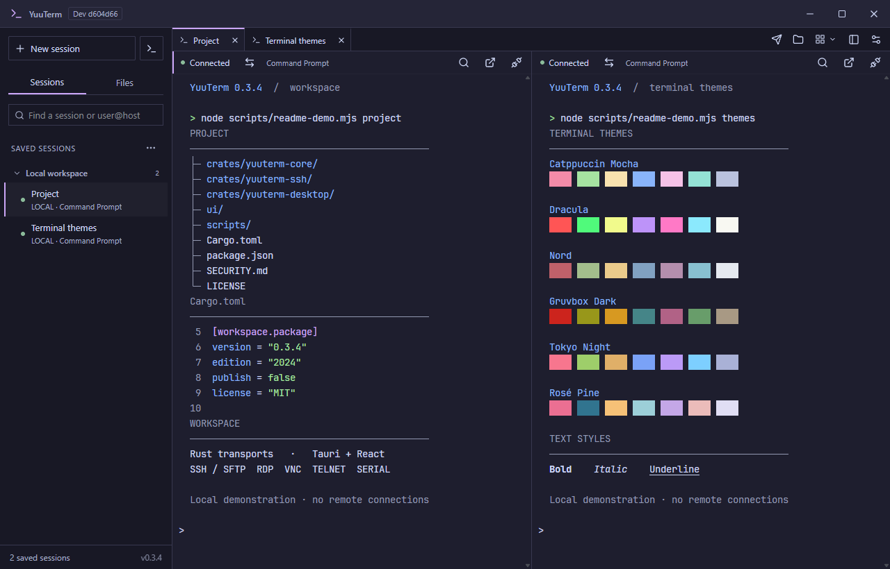

# YuuTerm

A terminal and remote session manager for Windows. SSH with a file browser,
RDP, VNC, Telnet, serial ports and local shells, all in one window.



This is an early preview and most of it was vibe-coded, so expect bugs.

## Features

- **Sessions:** SSH, RDP, VNC, Telnet, serial (COM) and local shells
  (PowerShell, Command Prompt, Git Bash, WSL); saved sessions in groups, quick
  connect from the search field
- **SSH gateways:** SSH, RDP, VNC and Telnet sessions through jump hosts
- **SFTP file browser** next to the SSH terminal: upload, download, rename,
  permissions (rwx/octal), and editing in your own editor with upload on save
- **X11 forwarding** over SSH with a bundled X server
- **Layout:** tabs, split panes and pop-out terminal windows
- **Broadcast:** type into several sessions at once
- **Terminal:** comes in different themes, with keyword highlighting, search and
  session logs
- **Credentials:** passwords in the Windows Credential Manager, SSH agent or key
  files

## Download

Get the installer or the portable ZIP from the
[releases page](https://github.com/welcometopwn/yuuterm/releases).

The builds aren't signed yet, so SmartScreen will probably warn you about an
unknown publisher. If WebView2 is missing, Windows asks you to install it.

Settings stay on your PC, and saved passwords go into the Windows Credential
Manager. The portable version keeps its settings next to the exe.

Once per start, YuuTerm asks GitHub whether a newer release exists and only tells
you; it never downloads or installs anything. Turn it off in Settings > General.

## Building

You need Rust, Node.js, WebView2 and the Visual Studio Build Tools (C++ desktop
workload and Windows SDK). Then:

```powershell
npm ci
npm run desktop:build
```

Details are in [docs/building.md](docs/building.md). See also
[SECURITY.md](SECURITY.md) and the [third-party licenses](THIRD_PARTY_NOTICES.md).

## License

[MIT](LICENSE), © 2026 welcometopwn
