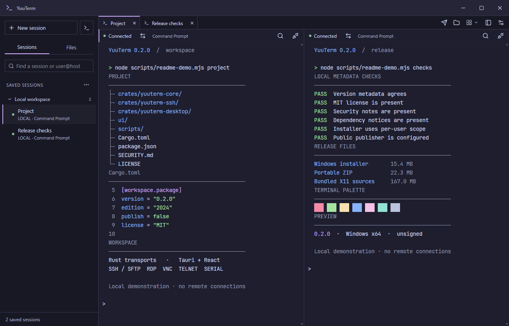

# YuuTerm

A terminal and remote session manager for Windows. SSH with a file browser,
RDP, VNC, Telnet, serial ports and X11 forwarding, all in tabs and split panes
in one window.



This is an early preview and most of it was vibe-coded, so expect bugs.

## Download

Get the installer or the portable ZIP from the
[releases page](https://github.com/welcometopwn/yuuterm/releases). Runs on
Windows 10 or 11 (x64); so far it has only been tested on Windows 11.

The builds aren't signed yet, so SmartScreen will probably warn you about an
unknown publisher. If WebView2 is missing, Windows asks you to install it.

Settings stay on your PC, and saved passwords go into the Windows Credential
Manager. The portable version keeps its settings next to the exe.

## Building

You need Rust, Node.js, WebView2 and the Visual Studio Build Tools (C++ desktop
workload and Windows SDK). Then:

```powershell
npm ci
npm run desktop:build
```

Details are in [docs/building.md](docs/building.md). See also
[SECURITY.md](SECURITY.md) and the [third-party licenses](THIRD_PARTY_NOTICES.md).

## License

[MIT](LICENSE), © 2026 welcometopwn
